

  

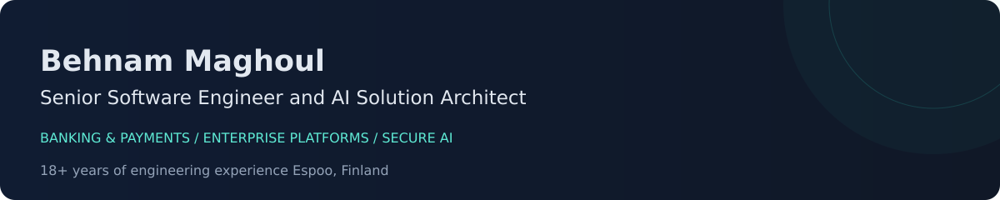

  
  
  

I build and modernize **enterprise software**, with a foundation in **C#/.NET, banking and payments** and recent work in **data platforms and secure AI integration**. My work combines architecture with hands on development, from APIs and transaction workflows to web and desktop applications.

At **DSharp**, I develop enterprise analytics and AI assisted SQL and metadata workflows. Previously, I worked on **FNZ wealth management platforms** and banking systems for settlement, accounting, ACH/RTGS transfers and anti money laundering.

<a href="#selected-work">Selected work</a> &nbsp;·&nbsp; <a href="#engineering-focus">Engineering focus</a> &nbsp;·&nbsp; <a href="#technology-toolkit">Toolkit</a> &nbsp;·&nbsp; <a href="#architecture-in-practice">Architecture</a> &nbsp;·&nbsp; <a href="#experience-and-learning">Experience</a>

<table>
<tr>
<td width="50%" valign="top">

### 🛡️ MCP Sentinel

**Policy enforcement for AI tools**

Authorization independent of model decisions, fail closed allow/deny rules and sanitized audit records.

`C#` ` .NET 10` `MCP SDK` `Automated tests`

[Explore repository →](https://github.com/DarkExpert/mcp-sentinel)

</td>
<td width="50%" valign="top">

### 🔐 MCP Access Control Studio

**Identity and permissions for MCP**

Role based tool enforcement, JWT authentication and persistent security audit reporting. Early reference implementation.

`C#` `.NET 10` `MCP` `SQLite`

[Explore repository →](https://github.com/DarkExpert/McpAccessControlStudio)

</td>
</tr>
<tr>
<td width="50%" valign="top">

### ⚡ Webhook Guardian

**Reliable webhook processing**

HMAC verification, persistent idempotency and duplicate protection, with automated tests and setup documentation.

`TypeScript` `Node.js` `Fastify` `SQLite`

[Explore repository →](https://github.com/DarkExpert/WebhookGuardian)

</td>
<td width="50%" valign="top">

### 💬 SupabaseClientFlow

**AI support and booking workflows**

Owner isolated chat, persisted support requests, duplicate booking prevention and server enforced AI quotas.

`React` `TypeScript` `Supabase` `OpenAI`

[Explore repository →](https://github.com/DarkExpert/SupabaseClientFlow)

</td>
</tr>
</table>

**🤖 [BotForge](https://github.com/DarkExpert/BotForge)** — Telegram bot orchestration with a React admin dashboard, localization and database migrations. Built with Python, FastAPI, aiogram and PostgreSQL.

These public reference projects document their setup and scope; capabilities and limitations are described in each repository.

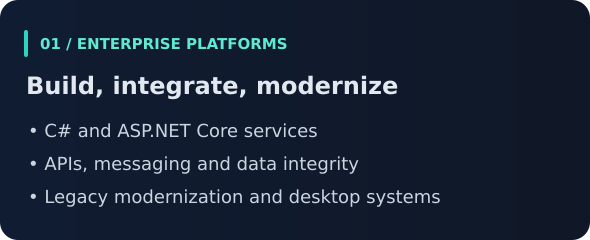 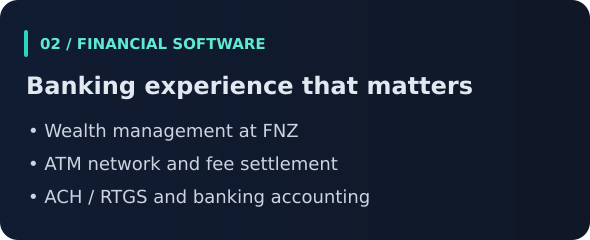

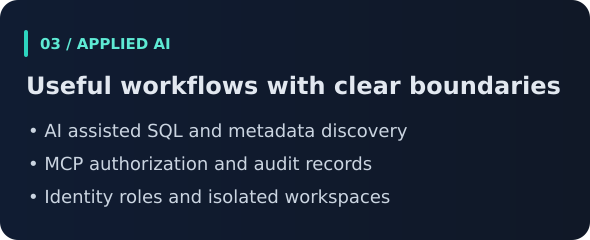 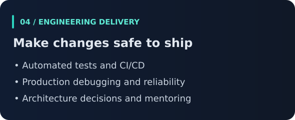

 &nbsp;  &nbsp;  &nbsp;  &nbsp;  &nbsp;  &nbsp;  &nbsp;  &nbsp;  &nbsp;  &nbsp;  &nbsp;  &nbsp;  &nbsp;  &nbsp;  &nbsp;  &nbsp;  &nbsp;  &nbsp; 

### Backend engineering

           

### Web and desktop

             

### Databases and analytics

           

### Architecture and quality

           

### Cloud and delivery

           

### AI and application security

            

### Proficiency overview

Indicative proficiency estimates based on professional experience and recent project work. These are not standardized test scores or certification results.

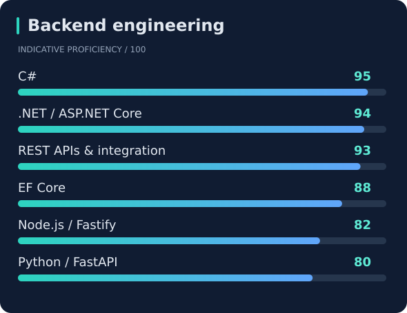
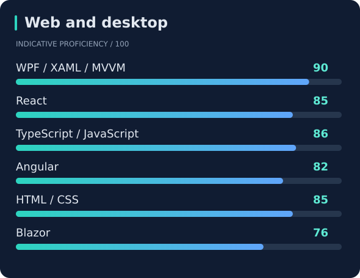

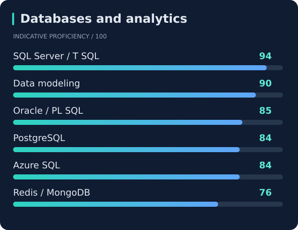
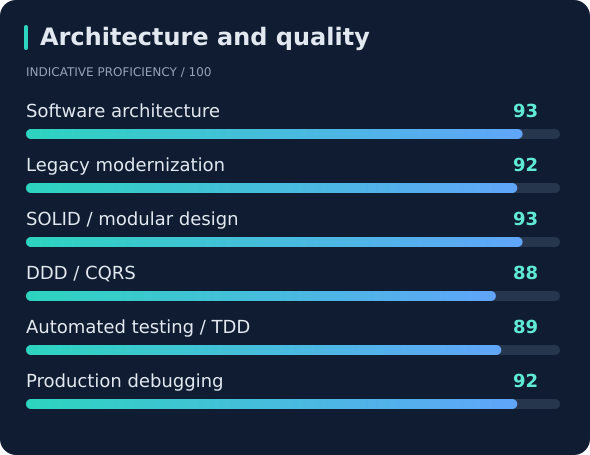

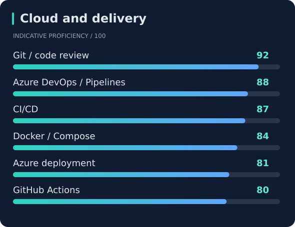
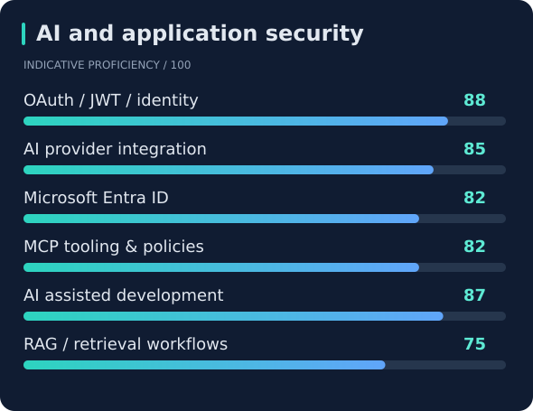

<strong>Additional tools and practical training</strong>

MSMQ, WSO2, Azure Service Bus, Umbraco, Stimulsoft, DB2 and SQLite. AWS SimuLearn labs include EC2, S3, IAM, Lambda and Amazon Bedrock; Azure AI Foundry labs include guardrails and evaluation. Training exposure is separate from the proficiency estimates above.

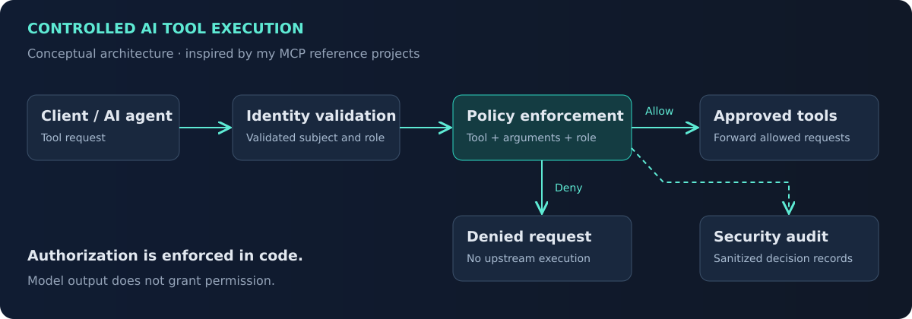

This diagram illustrates a pattern used in my MCP work, rather than a deployment shared by every project. Each implementation defines its own enforcement and audit behavior.

| Experience | Selected contributions |
| :--- | :--- |
| **DSharp · Enterprise data & AI** | Data modeling, schema discovery, AI assisted analytical workflows, Entra ID roles and reliability improvements. |
| **FNZ · Wealth management** | Financial platform features, production problem solving, automated testing and delivery with Azure DevOps. |
| **TOSAN TECHNO · Payments** | Instant settlement across 3,800 ATMs, fee settlement for 15,000 stockholders and secure banking integrations. |
| **Earlier banking systems** | ACH/RTGS transfers, banking accounting modernization, asset management and anti money laundering software. |

<strong>🎓 Education and continued learning</strong>

- **Bachelor of Computer Engineering** — Azad University, Qazvin.
- **AWS SimuLearn: Generative AI Architect** — practical training.
- **AWS Agentic AI Demonstrated** — badge.
- **Azure AI Foundry labs** — practical exercises in guardrails, blocklists and evaluation.
- **Azure Developer Associate AZ-204 Specialization** — Coursera course specialization.

<strong>🌍 Languages and location</strong>

Based in **Espoo, Finland**. Persian: native · English: upper intermediate professional working proficiency · Finnish: beginner.

---

<strong>Let's build software people can rely on.</strong>

Senior engineering and architecture roles · Focused consulting engagements

<a href="https://www.linkedin.com/in/behnam-m-24140453/">Connect on LinkedIn</a> &nbsp;·&nbsp; <a href="mailto:b.maghoulshabestari@gmail.com">Get in touch</a>

